<div align="center">

  <!-- HEADER BANNER -->
  

  <!-- DYNAMIC TYPING SVG -->
  <a href="https://github.com/gbetokuon-stack">
    
  </a>

  <br/><br/>

  <!-- STATUS BADGES -->
  <p align="center">
    
    
    
    
  </p>

  <!-- LIÊN HỆ & MẠNG XÃ HỘI (CONNECT & SOCIALS) -->
  <p align="center">
    <a href="https://www.facebook.com/profile.php?id=100004465804397" target="_blank">
      
    </a>
    <a href="https://discord.com/users/cuongacoustic" target="_blank">
      
    </a>
    <a href="mailto:your_email@gmail.com">
      
    </a>
    <a href="https://linkedin.com/in/YOUR_LINKEDIN" target="_blank">
      
    </a>
    <a href="https://t.me/YOUR_TELEGRAM" target="_blank">
      
    </a>
  </p>

</div>

---

### 💻 HỒ SƠ LẬP TRÌNH VIÊN (ABOUT ME)

```typescript
/**
 * Developer Profile & Core Competencies
 */

interface Developer {
  name: string;
  role: string;
  languages: string[];
  techStack: {
    frontend: string[];
    backend: string[];
    database: string[];
    devops: string[];
  };
  currentFocus: string[];
  interests: string[];
}

const developer: Developer = {
  name: "Cường",
  role: "Full-Stack Software Engineer",
  languages: ["TypeScript", "JavaScript", "Python", "Go", "SQL"],
  techStack: {
    frontend: ["React", "Next.js", "Vue.js", "Tailwind CSS"],
    backend: ["Node.js", "Express", "NestJS", "FastAPI"],
    database: ["PostgreSQL", "MongoDB", "Redis"],
    devops: ["Docker", "Kubernetes", "CI/CD", "AWS"]
  },
  currentFocus: [
    "Xây dựng hệ thống phân tán quy mô lớn & hiệu năng cao",
    "Nghiên cứu ứng dụng AI Agent & Kiến trúc tự động hóa"
  ],
  interests: ["Acoustic Music & Guitar 🎸", "Coffee ☕", "Tech Articles 📚"]
};
```

---

<div align="center">
  <h2>🏆 THÀNH TỰU GITHUB (GITHUB TROPHIES)</h2>
  <br/>
  <a href="https://github.com/ryo-ma/github-profile-trophy">
    
  </a>
</div>

---

### 🛠️ KỸ NĂNG & CÔNG NGHỆ (SKILLS & TECHNOLOGIES)

<div align="center">

  #### 💻 Frontend Development
  <p>
    <a href="https://skillicons.dev">
      
    </a>
  </p>

  #### ⚙️ Backend Development
  <p>
    <a href="https://skillicons.dev">
      
    </a>
  </p>

  #### 🗄️ Database & Storage
  <p>
    <a href="https://skillicons.dev">
      
    </a>
  </p>

  #### ☁️ DevOps & Cloud
  <p>
    <a href="https://skillicons.dev">
      
    </a>
  </p>

</div>

---

### 📊 THỐNG KÊ HOẠT ĐỘNG (GITHUB METRICS)

<div align="center">
  <table>
    <tr>
      <td align="center" style="background-color: #0d1117; border: 1px solid #30363d;">
        
      </td>
      <td align="center" style="background-color: #0d1117; border: 1px solid #30363d;">
        
      </td>
    </tr>
  </table>

  <br/>

  <!-- CONTRIBUTION STREAK -->
  

</div>

---

### 📈 BIỂU ĐỒ HOẠT ĐỘNG (ACTIVITY GRAPH)

<div align="center">
  
</div>

---

### 📊 BIỂU ĐỒ ĐÓNG GÓP HOẠT ĐỘNG (ANIMATED CONTRIBUTION GRAPH)

<div align="center">
  
</div>

---

### 🚀 DỰ ÁN TIÊU BIỂU (FEATURED PROJECTS)

| Dự Án | Mô Tả & Tính Năng | Công Nghệ | Trạng Thái |
| :--- | :--- | :--- | :---: |
| ⚡ **[Trading-Engine](https://github.com/gbetokuon-stack/trading-engine)** | Hệ thống xử lý giao dịch thời gian thực với độ trễ thấp, xử lý hàng triệu requests | `Rust` `WebSockets` `Redis` | []() |
| 👁️ **[Vision-AI-Agent](https://github.com/gbetokuon-stack/vision-ai-agent)** | Hệ thống thị giác máy tính và AI Agent phát hiện bất thường qua camera thời gian thực | `Python` `PyTorch` `FastAPI` | []() |
| 🔗 **[Decentral-Chain](https://github.com/gbetokuon-stack/decentral-chain)** | Giao thức đồng thuận và sổ cái phân tán với thuật toán mã hóa bảo mật cao | `Solidity` `Go` `Docker` | []() |

---

<!-- FOOTER -->
<div align="center">
  
  
  <p align="center">
    <sub>"Talk is cheap. Show me the code." — Linus Torvalds</sub>
  </p>
</div>
